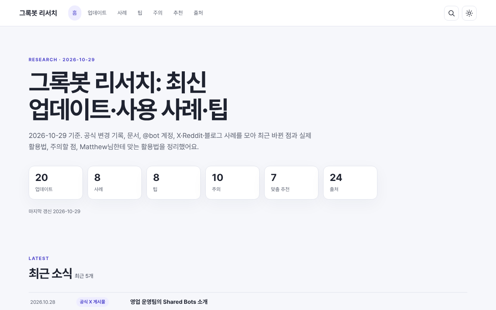
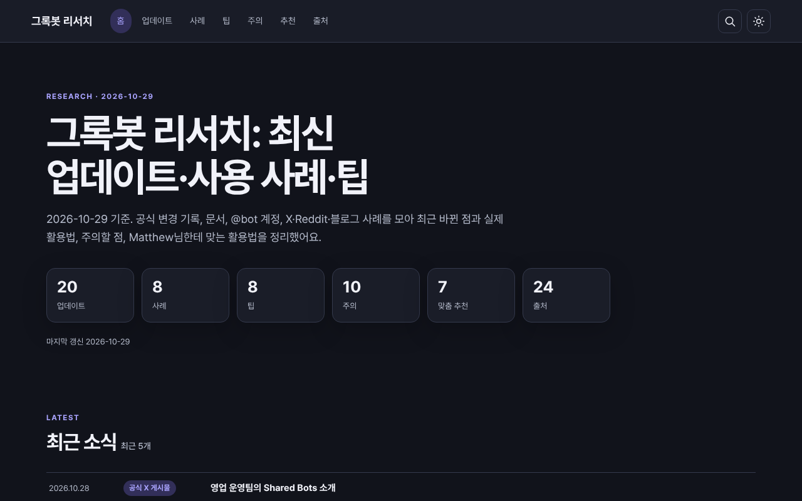

# 그록봇 리서치

2026년 10월 29일 기준 그록봇 업데이트, 사용 사례, 실전 팁과 주의점, Matthew님 맞춤 활용법을 모은 정적 한국어 리서치 사이트입니다.

## 미리 보기


[데스크톱 전체 페이지](docs/screenshots/desktop.png)


[모바일 전체 페이지](docs/screenshots/mobile.png)


[다크 모드 전체 페이지](docs/screenshots/desktop-dark.png)

## 실행

저장소 루트에서 실행한 뒤 http://127.0.0.1:18791 를 여세요.

```sh
python3 -m http.server 18791
```

## 폴더 구조

- `index.html`: 사이트 진입점
- `assets/`: 화면 스타일 및 `assets/js/` 역할별 ES 모듈
- `data/`: 화면에 표시할 JSON 데이터
- `scripts/validate.mjs`: 데이터 규칙 검사
- `scripts/screenshot.py`: Playwright 스크린샷 생성
- `docs/`: 설계, 원문 조사, 스크린샷

## 새 조사 추가 방법

해당 배열에 항목을 추가하고 `added_at`에 입력한 날짜를 `YYYY-MM-DD`로 기록합니다. 예를 들어 팁은 다음 형태입니다.

```json
{
  "id": "tip-new-example",
  "date": "2026-10-29",
  "title": "예시 팁 제목",
  "summary": "원문에서 확인한 팁 내용입니다.",
  "tags": ["루틴"],
  "sources": [{ "title": "Routines 도움말", "url": "https://cursor.com/help/grok-bot/routines" }],
  "added_at": "2026-10-29",
  "order": 9
}
```

업데이트는 `data/updates.json`에 `version`(없으면 `null`)과 `kind`를 추가합니다.

```json
{"id":"update-example","date":"2026-10-29","title":"업데이트 제목","summary":"확인된 내용","tags":["Pages"],"sources":[{"title":"Grok Bot Changelog","url":"https://x.ai/changelog/bot"}],"added_at":"2026-10-29","version":null,"kind":"release-note"}
```

사례는 `actor`, `category`, `metrics`를 포함합니다. 수치가 원문에 없으면 빈 배열로 둡니다.

```json
{"id":"usecase-example","date":"2026-10-29","title":"사례 제목","summary":"사례 내용","tags":["개발자"],"sources":[{"title":"Work with Grok Bot","url":"https://cursor.com/docs/grok-bot/work"}],"added_at":"2026-10-29","actor":"개발자","category":"개발자","metrics":[]}
```

항목을 추가할 때 새 출처는 `sources.json`에도 등록하고 `meta.json`의 `last_updated`를 갱신하세요. 그 뒤 다음 명령으로 검사합니다.

```sh
node scripts/validate.mjs
```

NEW 배지는 `added_at`이 `meta.baseline_added_at`보다 이후이고 `meta.last_updated` 기준 7일 이내인 항목에 표시합니다.

## 데이터 원칙

원문에서 확인되지 않은 사실, 수치, URL은 만들지 않습니다. 각 항목에는 근거 출처 링크를 붙이고, 출처가 원문에서 명시되지 않은 경우 원본 리서치 Page를 사용합니다. 날짜는 사건이나 게시 날짜이며, 등록 날짜는 `added_at`에 기록합니다.
